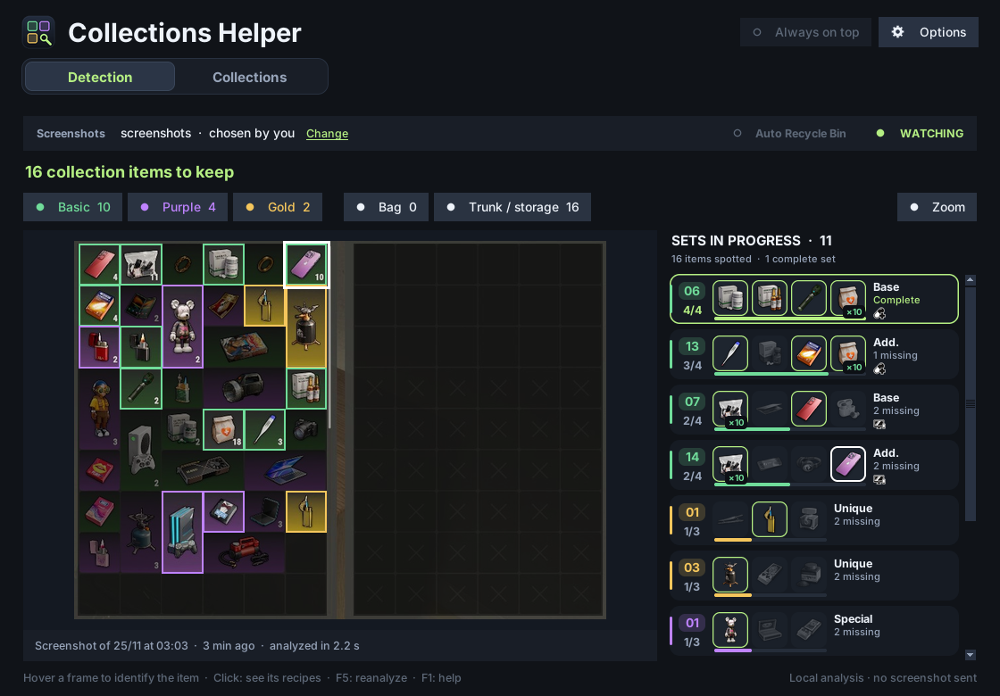
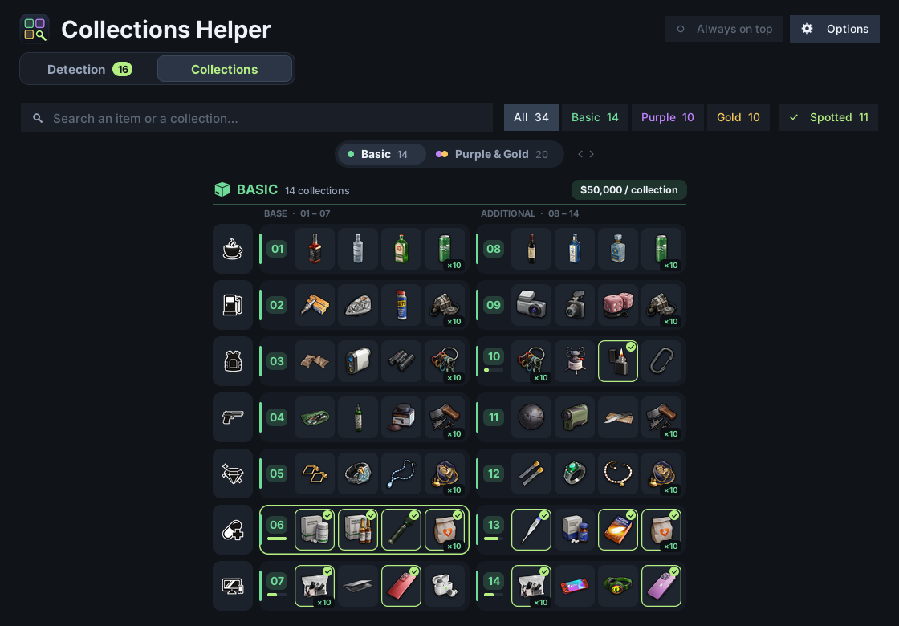
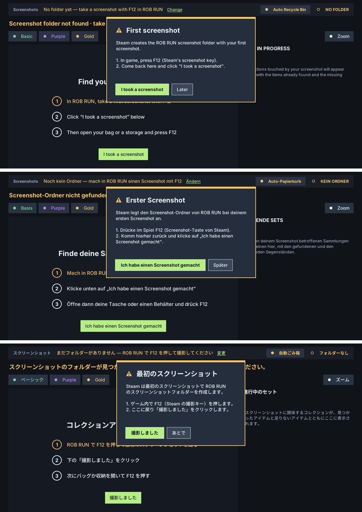

<p align="center">
  
</p>

<h1 align="center">Collections Helper</h1>

<p align="center">
  A Windows companion for <b>ROB RUN</b>: press <kbd>F12</kbd> in game and instantly see which items in your bag
  or trunk belong to a collection, which sets they complete, and where to find the missing pieces.
</p>

<p align="center">
  
</p>

---

## Contents

- [Features](#features)
- [Install](#install)
- [How to use](#how-to-use)
- [How it works](#how-it-works)
- [Languages](#languages)
- [Privacy and anti-cheat](#privacy-and-anti-cheat)
- [Build from source](#build-from-source)
- [Project structure](#project-structure)
- [Credits and license](#credits-and-license)

## Features

- **Automatic analysis of Steam screenshots.** The app watches ROB RUN's Steam screenshot folder; each new
  <kbd>F12</kbd> capture is analyzed in about half a second.
- **Items worth keeping are framed** in the bag, a storage or a car trunk, colored by collection tier
  (green = Basic, violet = Purple, gold = Gold). Every other slot is dimmed.
- **Sets in progress.** Every collection touched by the screenshot, with found items lit and missing ones faded,
  the most complete first. Hover a frame to highlight the item in its sets, and the other way round.
- **Collections tab.** All 34 recipes on two pages (Basic, then Purple & Gold), grouped by game location, with the
  reward value of each crate. Hover any item to see where to find it (sellers, prices, furniture to search, random
  spots). Search by item or collection name in any game language.
- **Optional auto Recycle Bin.** Analyzed screenshots can be moved to the Windows Recycle Bin (recoverable), so the
  screenshot folder does not fill up.
- **13 interface languages**, chosen automatically.

<p align="center">
  
</p>

## Install

1. Download `RobRunCollections-Setup-x.y.z.exe` from the [Releases](../../releases) page.
2. Run it. No administrator rights are needed; the app is installed for the current Windows user only.
3. Launch **Collections Helper** from the Start menu.

> [!NOTE]
> The installer and the executable are not code-signed, so Windows SmartScreen may show
> *"Windows protected your PC"*. Click **More info › Run anyway**. Some antivirus programs are also wary of
> PyInstaller executables in general.

You can also use the stand-alone `RobRunCollections.exe` from a release: it contains everything and needs no
installation.

## How to use

1. Start Collections Helper and keep it open. It finds ROB RUN's Steam screenshot folder by itself.
   - Steam only creates that folder with your **first** screenshot of the game. If it does not exist yet, the app
     asks you to take one with <kbd>F12</kbd> in ROB RUN, then to click **I took a screenshot**. If the folder still
     cannot be found (another screenshot key or tool), you choose it by hand.
2. In game, open your bag, a storage, or a car trunk (first tab active).
3. Press <kbd>F12</kbd>. The result appears in the app a moment later.

Useful shortcuts: <kbd>F5</kbd> reanalyze · <kbd>Ctrl</kbd>+<kbd>O</kbd> analyze any image ·
<kbd>Ctrl</kbd>+<kbd>F</kbd> search · <kbd>Ctrl</kbd>+<kbd>1</kbd> / <kbd>Ctrl</kbd>+<kbd>2</kbd> switch tab ·
<kbd>←</kbd> <kbd>→</kbd> collection pages · <kbd>F1</kbd> help.
Right-click the screenshot to reanalyze or to set the bag / trunk areas by hand.

## How it works

1. **Finding the screenshot folder.** The Steam install is read from the registry, then every Steam account's
   `userdata\<account>\760\remote\4262460\screenshots` folder is checked (4262460 is ROB RUN's Steam app id).
   With several accounts, the folder with the most recent screenshot wins. The folder is polled every 100 ms and
   a screenshot is analyzed as soon as the file is complete.
2. **Locating the inventories, without reading any text.** Inventory grids are the only places on screen where
   dividers repeat every 62 UI pixels both horizontally and vertically. An edge-based lattice search finds the
   6 × 9 bag grid (the rightmost one) at any resolution or UI scale; a storage (9 rows, level with the bag) or a car
   trunk (8 rows below its tab bar) is the grid on its left. A car trunk is only read while its first tab is the
   active (lime) one. The position is cached, so later screenshots are faster.
3. **Recognizing items.** Each slot is matched against the game's own item icons with OpenCV template matching
   (a coarse pass at half resolution, then a precise masked pass), in parallel threads. Visually similar
   non-collection variants are used as negative examples, and uncertain matches are discarded.

## Languages

The interface language is picked automatically: the language chosen in ROB RUN, otherwise the one set for the game
in Steam, otherwise Windows' display language. It can be changed in **Options › Language**.

| | Languages |
|---|---|
| **Game languages** (item and place names taken from the game files) | English, French, German, Spanish, Portuguese, Russian |
| **Interface only** (item names in English) | Italian, Polish, Turkish, Ukrainian, Simplified Chinese, Japanese, Korean |

The installer also follows the Windows language. Interface translations live in
[`src/data/i18n.json`](src/data/i18n.json); corrections from native speakers are very welcome.

<p align="center">
  
</p>

## Privacy and anti-cheat

- Everything runs locally. No account, no telemetry, no network connection while in use (the only exception is
  the optional *Open its page on robrunstash* menu entry, which opens your browser).
- The app **never touches the game process**: no memory reading, no injection, no overlay, and no keyboard hook.
  It only reads the screenshots Steam writes to disk. ROB RUN uses Easy Anti-Cheat, and this design keeps the tool
  entirely outside the game.
- The only files written are next to the executable: `settings.json`, `application.log` and
  `last-result.json` (the last result).

## Build from source

Requirements: Windows 10/11, Python 3.12 (64-bit) and, for the installer, [NSIS 3](https://nsis.sourceforge.io)
(`winget install NSIS.NSIS`). Build from a Python where `requirements.txt` is installed: PyInstaller only bundles the
packages it can import, and `build.ps1` stops if one is missing.

```powershell
git clone https://github.com/LCozzoli/RobRunCollectionsHelper.git
cd RobRunCollectionsHelper
python -m venv .venv
.venv\Scripts\Activate.ps1
pip install -r requirements.txt

python src\app.py                 # run from source
.\build.ps1 -Test                 # run the tests, then build dist\RobRunCollections.exe
.\build.ps1 -Version 1.2.0        # also build dist\RobRunCollections-Setup-1.2.0.exe
```

Tests (they open a Tk window briefly and never move the mouse):

| Script | Checks |
|---|---|
| `tests/test_detection.py` | Expected items and zones on 8 sample screenshots (1440×1080, 1920×1080, 1920×1440), also with every title painted over |
| `tests/test_folder.py` | Steam folder discovery, first-screenshot flow, watcher, Recycle Bin rules |
| `tests/test_interface.py` | Tabs, filters, collections pages and layout at 1920×1080, hover links, window geometry, all 13 languages |

## Project structure

```
src/
  app.py               Main window: Detection tab, options, folder handling, Windows integration
  collections_view.py  Collections tab, item origins, tooltips
  detector.py          Inventory lattice search and item recognition
  watcher.py           Steam folder discovery and screenshot polling
  cleanup.py           Safe move to the Recycle Bin after analysis
  i18n.py              Language detection and translations
  icons.py             Antialiased UI icons drawn with Pillow
  data/                Item catalogue, icons, origins, translations, app icon
installer/             NSIS installer script and its translations
tests/                 Test scripts and sample screenshots
tools/build_icon.py    Regenerates the app icon
docs/                  README images and the user guide installed with the app (USER_GUIDE.txt)
build.ps1              Tests, executable and installer build
```

## Credits and license

- Code: © SegFault, released under the [GNU General Public License v3.0](LICENSE).
- **ROB RUN**, its item icons, location icons and in-game texts are the property of their respective owners and
  are included here only so the tool can recognize and name items. This is an unofficial fan tool, not affiliated
  with or endorsed by the game's developers.
- Collection recipes and item origins: community data from
  [robrunstash.vercel.app](https://robrunstash.vercel.app/) (retrieved November 2026).
